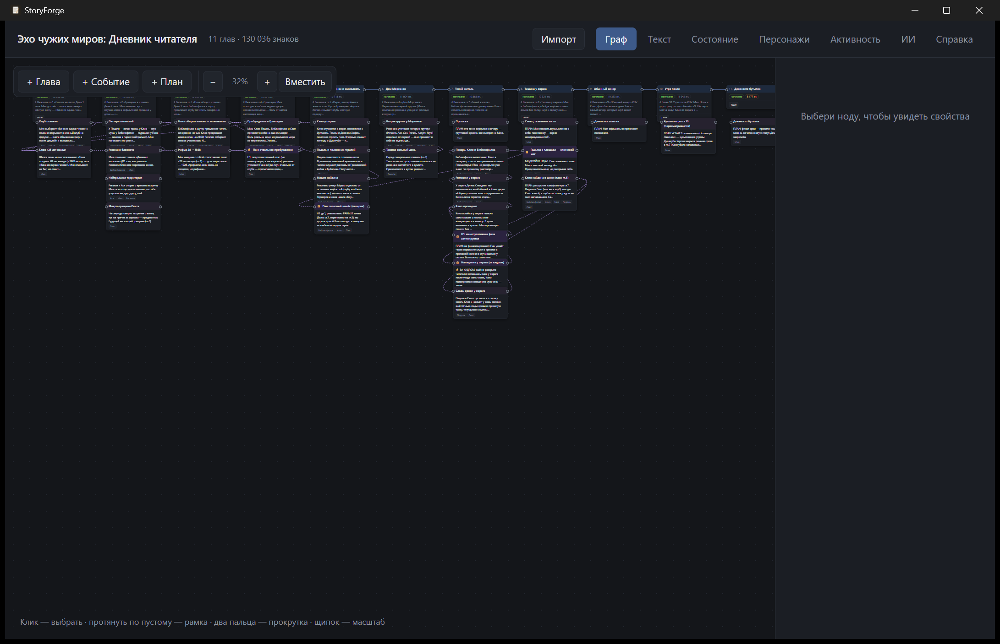
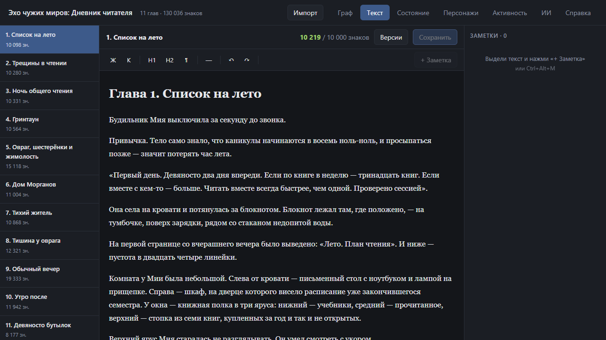

# StoryForge

**Среда для написания книг.** Граф сюжета вместо линейного списка глав, редактор с
заметками, база «мира» с фактами на любой момент истории и MCP-сервер, чтобы модель
могла читать и писать книгу напрямую.

Переписано с Node.js на Rust: одно окно, один процесс, встроенная SQLite. Node.js на
машине не нужен — ни для запуска, ни для сборки.





---

## Установка

Скачайте `StoryForge_0.1.0_x64-setup.exe` из [Releases](../../releases) и запустите.

- Установка для текущего пользователя, права администратора не нужны.
- Нужен Windows 10/11; WebView2 уже есть в системе.
- Установщик не подписан, поэтому SmartScreen покажет «Неизвестный издатель» —
  «Подробнее» → «Выполнить в любом случае».
- Кнопка «Только распаковать» (portable) кладёт `StoryForge.exe` в папку без установки.

## Первый запуск

Приложение открывает базу из `%APPDATA%\StoryForge\data\story.db`; при первом
запуске она создаётся пустой. Книг нет — на пустом экране нажмите **«Импортировать книги»**,
и приложение разберёт markdown-библию из соседних папок (там, где лежит `book.md`).

Открыть **уже существующую** базу (например, от прежней Node-версии) можно двумя способами:

```jsonc
// %APPDATA%\StoryForge\config.json
{ "db_path": "D:\\Books\\StoryForge\\data\\story.db" }
```

или переменной окружения `STORYFORGE_DB` с путём к файлу `story.db`.

Импорт/экспорт работают с папкой книги: `book.md`, `chapters/chNNN.md`, `bible/`,
`plot/`, `timeline/`, `state/`. Переимпорт не стирает то, чего нет в markdown —
заметки, факты, раскладку графа, историю версий.

## Экраны

| Экран | Что делает |
|---|---|
| **Граф** | холст с нодами глав, событий и свободных планов. Панорама, масштаб, рамка выделения, связи между нодами, групповые действия |
| **Текст** | редактор главы: форматирование, счётчик знаков, версии, сохранение с проверкой ревизии |
| **Заметки** | карточки справа от текста; фрагмент подсвечивается в тексте и переживает правки выше по главе |
| **Состояние** | срез мира на выбранный момент: кто где, что знает, что при себе, какие ружья висят |
| **Персонажи** | карточки: характер, голос, эволюция по главам, связи, появления |
| **Активность** | что модель записала в книгу через MCP |
| **ИИ** | диалог по книге и главе, контекст сцены, извлечение фактов, план и черновик |
| **Справка** | ружья, тайны, таймлайн, правила мира, глоссарий, события |

### Граф

Один палец — выбрать или перетащить, протяжка по пустому месту — рамка выделения,
два пальца — прокрутка, щипок — масштаб, правый клик — меню. `Ctrl+A` / `C` / `V` / `D`,
`Delete`, `Esc`, `Ctrl +/−/0`. Тянуть за правый кружок ноды и бросить на другую — связь.

### Текст и заметки

`Ctrl+B`, `Ctrl+I`, `Ctrl+Z`, `Ctrl+S`; `Ctrl+Alt+M` — заметка на выделенном тексте.
Заметка без текста удаляется сама. На диске остаётся обычный markdown: сохранение без
правок не меняет ни символа.

Цикл правки с моделью: **«Собрать для ИИ»** копирует промпт с заметками и абзацами,
**«Применить правки»** принимает JSON с заменами и проверяет каждую — неоднозначная или
ненайденная замена отклоняется с причиной, текст в этих местах не трогается.

## ИИ

«Настройки API» → DeepSeek или OpenRouter, модель и ключ → «Проверить подключение».
Ключи лежат в `%APPDATA%\StoryForge\ai-config.json`, в интерфейс и логи не возвращаются.

Режимы в панели ИИ: **«Диалог · только ответ»** (обсуждение, книга не меняется) и
**«Агент · меняет книгу»** (вызовы инструментов: чтение состояния, запись главы, факты).
Переписка хранится в локальной базе отдельно для книги и для главы.

## MCP

Пока приложение запущено, MCP доступен на `http://127.0.0.1:5123/mcp`.

```bash
claude mcp add --transport http storyforge http://127.0.0.1:5123/mcp
```

Есть и stdio-транспорт — `storyforge-mcp.exe` читает JSON-RPC со stdin. Оба транспорта
работают через один набор: 22 инструмента (состояние, факты, главы, персонажи, события,
связи), 9 ресурсов книги (`storyforge://<slug>/<key>`) и промпт `write_chapter`.

## Сборка из исходников

Нужны Rust stable и MSVC build tools; Node.js не требуется.

```powershell
cargo build --release                 # storyforge.exe
cargo tauri build                     # окно + установщик NSIS
pwsh scripts/package.ps1              # installer/out: setup.exe + portable zip
cargo run -p storyforge               # окно
cargo run -p storyforge -- --serve    # только сервер, печатает URL
cargo test -p storyforge-core         # 46 тестов
```

## Структура

```
crates/core      SQLite (схема один в один), markdown-импорт/экспорт, якоря заметок,
                 временные срезы мира, клиенты DeepSeek/OpenRouter, поверхность MCP
crates/mcp       MCP по stdio поверх того же dispatch
src-tauri        окно, HTTP-API, встроенный интерфейс, упаковка NSIS
docs/analysis    полный разбор JavaScript-версии, по которому шёл порт
scripts          дифференциальные тесты против Node-бэкенда
```

## Что проверено, а что нет

Проверено: 29 из 29 эндпоинтов чтения отвечают байт-в-байт как Node-версия; запись
(глава, версии, заметки, правки, факты) — без расхождений; импорт реальной книги совпал
по счётчикам; экспорт прогнан на копии папки; MCP отдаёт 22 инструмента; 46 тестов.

Не проверено: ответы ИИ-провайдера живьём (нет ключа в среде сборки) и вручную не
пройдены экраны «Состояние», «Персонажи», «Активность», «Справка». Известное
расхождение: при отказе модели агент отвечает «Агент не выполнил действие…» вместо
сообщения о четырёх попытках записи главы.

## Лицензия

См. [LICENSE](LICENSE).
